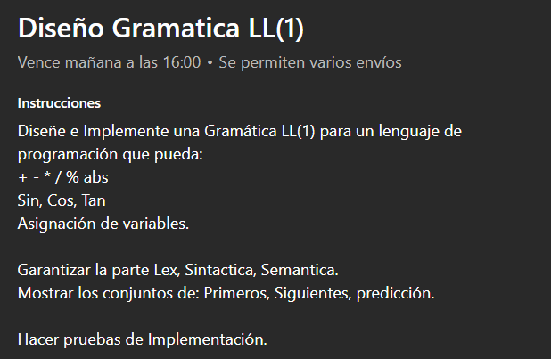
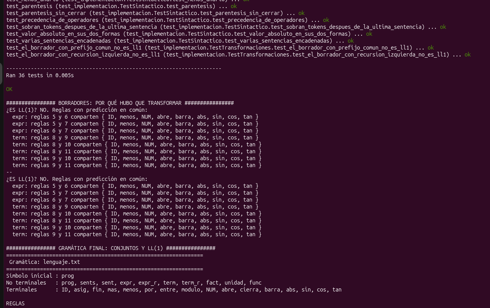
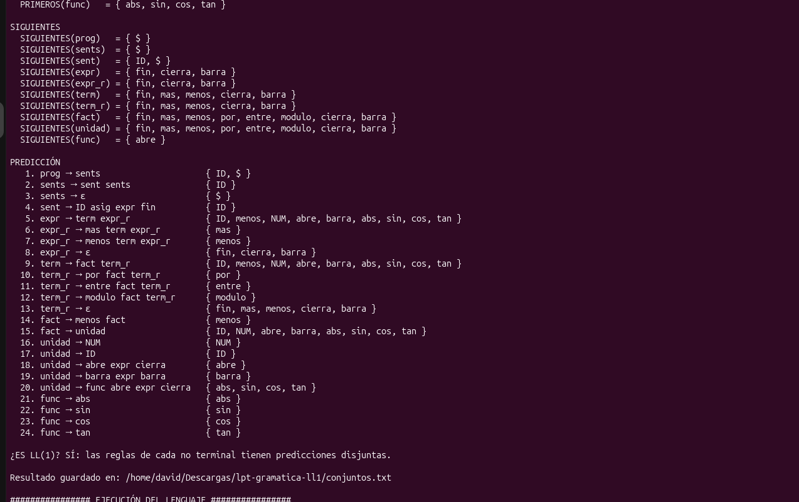
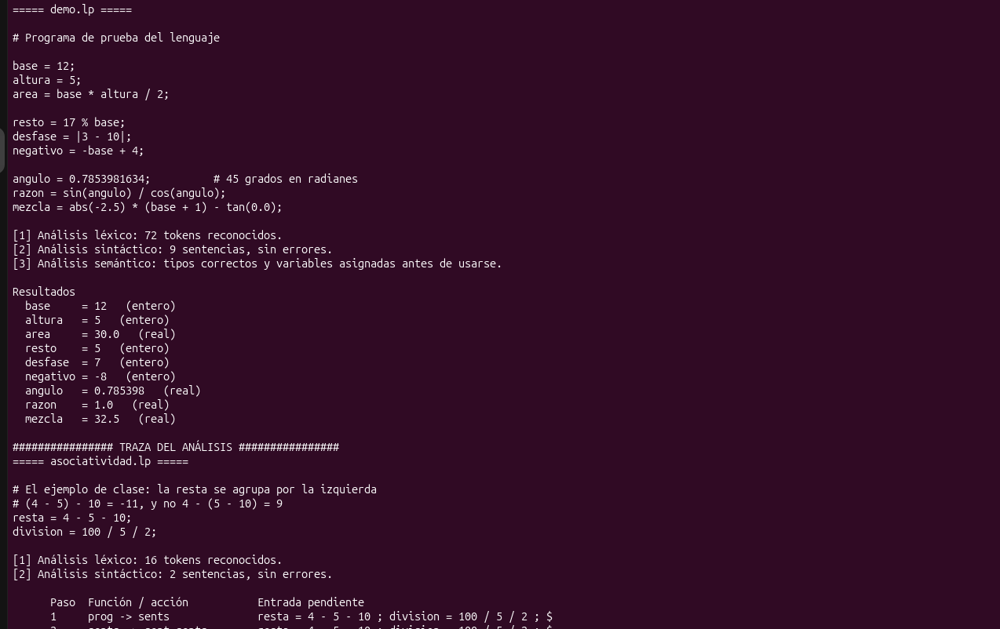
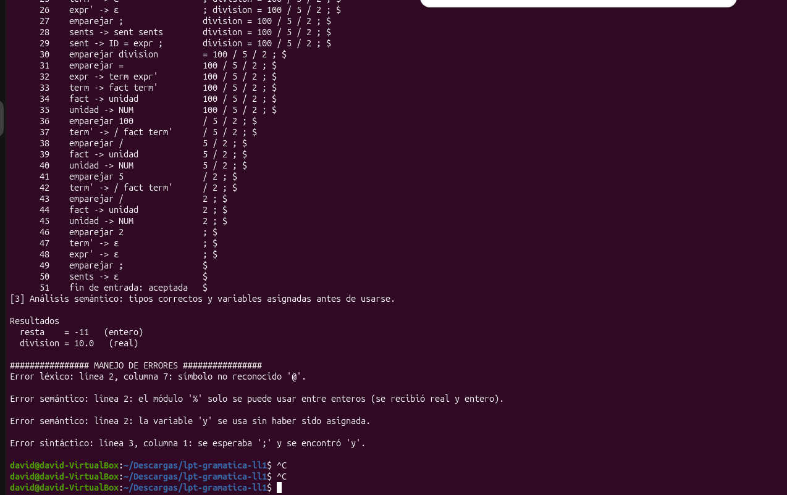

# Gramática LL(1) — lenguaje con aritmética, trigonometría y asignación

**Universidad Sergio Arboleda** · Facultad de Ingeniería en Ciencias de la Computación e IA
**Materia:** Lenguajes de Programación y Traducción
**Estudiante:** David Andrés Castellanos Angulo

📄 **Informe completo:** [`docs/informe_gramatica_ll1.pdf`](docs/informe_gramatica_ll1.pdf)

## Enunciado

Diseñar e implementar una gramática LL(1) para un lenguaje de programación que soporte `+ - * / %` y valor absoluto, las funciones `sin`, `cos`, `tan` y la asignación de variables. Hay que garantizar las fases léxica, sintáctica y semántica, mostrar los conjuntos de PRIMEROS, SIGUIENTES y PREDICCIÓN, y hacer pruebas de implementación.



## El lenguaje

```
# Programa de ejemplo
base = 12;
area = base * 5 / 2;          # 30.0, real porque hay división
resto = 17 % base;            # 5, el módulo solo va entre enteros
desfase = |3 - 10|;           # 7, valor absoluto
razon = sin(0.7853981634) / cos(0.7853981634);
```

- Números enteros y reales, comentarios con `#`, una sentencia por línea terminada en `;`.
- Valor absoluto en dos formas: `abs(x)` y `|x|`.
- `sin`, `cos` y `tan` trabajan en radianes.

## Cómo llegué a la gramática

No empecé por la versión final. Escribí primero la gramática como se lee en matemáticas y le apliqué las transformaciones de clase. Los dos borradores quedaron en `grammars/` para dejar constancia.

**Borrador 1 — recursión izquierda:**

```
expr -> expr mas term | expr menos term | term
```

Dice justo lo que uno quiere, pero `expr()` se llamaría a sí misma sin consumir ningún token. El programa lo confirma: las tres reglas de `expr` predicen los mismos tokens.

**Borrador 2 — prefijo común:**

```
expr -> term mas expr | term menos expr | term
```

Ya no hay recursión izquierda, pero las tres alternativas empiezan por `term`, así que habría que consumir todo un término antes de saber cuál regla es. Vuelve a dar conflicto.

**Transformación.** Con la regla `A → Aα | β  ⇒  A → βA'`, `A' → αA' | ε` queda la versión final. Factorizar el borrador 2 lleva al mismo sitio. En el archivo los llamé `expr_r` y `term_r` porque el apóstrofo no es cómodo en el código.

Para verlo:

```bash
python3 conjuntos.py grammars/borrador1_recursion.txt grammars/borrador2_prefijo.txt
```



## La gramática final

```
prog     -> sents
sents    -> sent sents | ε
sent     -> ID asig expr fin

expr     -> term expr_r
expr_r   -> mas term expr_r | menos term expr_r | ε

term     -> fact term_r
term_r   -> por fact term_r | entre fact term_r | modulo fact term_r | ε

fact     -> menos fact | unidad

unidad   -> NUM | ID | abre expr cierra | barra expr barra | func abre expr cierra
func     -> abs | sin | cos | tan
```

Tres cosas la dejan LL(1):

- **Precedencia con niveles.** `expr` para sumas y restas, `term` para producto, división y módulo, `fact` abajo. Por eso `2 + 3 * 4` da 14.
- **Sin recursión izquierda**, por la transformación anterior.
- **Sin prefijos comunes.** Cada alternativa de `unidad` empieza con un token distinto, y las cuatro funciones se agrupan en `func`.

Como las transformaciones cambian la gramática, los conjuntos hay que recalcularlos sobre la versión final: quitar la recursión izquierda no garantiza por sí solo que sea LL(1).

## Conjuntos y verificación LL(1)

```bash
python3 main.py --conjuntos
```

| No terminal | PRIMEROS | SIGUIENTES |
|---|---|---|
| prog | `{ID, ε}` | `{$}` |
| sents | `{ID, ε}` | `{$}` |
| sent | `{ID}` | `{ID, $}` |
| expr | `{ID, menos, NUM, abre, barra, abs, sin, cos, tan}` | `{fin, cierra, barra}` |
| expr_r | `{mas, menos, ε}` | `{fin, cierra, barra}` |
| term | `{ID, menos, NUM, abre, barra, abs, sin, cos, tan}` | `{fin, mas, menos, cierra, barra}` |
| term_r | `{por, entre, modulo, ε}` | `{fin, mas, menos, cierra, barra}` |
| fact | `{ID, menos, NUM, abre, barra, abs, sin, cos, tan}` | `{fin, mas, menos, por, entre, modulo, cierra, barra}` |
| unidad | `{ID, NUM, abre, barra, abs, sin, cos, tan}` | `{fin, mas, menos, por, entre, modulo, cierra, barra}` |
| func | `{abs, sin, cos, tan}` | `{abre}` |

Cada predicción sale de `PRED(A → α) = (PRIMEROS(α) − {ε}) ∪ SIGUIENTES(A)` cuando α es anulable, y de `PRIMEROS(α)` cuando no lo es. Las 24 están en `conjuntos.txt` y en el informe. La condición LL(1) es que dos reglas del mismo no terminal no compartan ningún token, y el programa las compara par por par:

```
¿ES LL(1)? SÍ: las reglas de cada no terminal tienen predicciones disjuntas.
```



## Las tres fases

| Módulo | Fase | Qué hace |
|---|---|---|
| `lexico.py` | léxica | arma los tokens con su línea y columna; detecta símbolos que no pertenecen al lenguaje |
| `sintactico.py` | sintáctica | descenso recursivo: una función por no terminal, `emparejar()` para los terminales, y al final comprueba que no sobren tokens |
| `semantico.py` | semántica | tabla de símbolos, tipos entero/real, variables asignadas antes de usarse; luego evalúa el programa |

### Asociatividad

Al quitar la recursión izquierda, la gramática quedó repitiendo por la derecha, pero `(4 - 5) - 10 = -11` y `4 - (5 - 10) = 9` no son lo mismo. La transformación no decide cómo evaluar: eso lo hacen las acciones semánticas. Por eso `expr_r` recibe un acumulador con lo que ya se construyó y lo va envolviendo. Hay una prueba automática para ese caso exacto.

### Traza

```bash
python3 main.py ejemplos/asociatividad.lp --traza
```



```
Paso  Función / acción        Entrada pendiente
1     prog -> sents           resta = 4 - 5 - 10 ; $
2     sents -> sent sents     resta = 4 - 5 - 10 ; $
3     sent -> ID = expr ;     resta = 4 - 5 - 10 ; $
4     emparejar resta         = 4 - 5 - 10 ; $
...
11    term' -> ε              - 5 - 10 ; $
12    expr' -> - term expr'   - 5 - 10 ; $
...
29    fin de entrada: aceptada  $
```



### Reglas semánticas

Reglas semánticas: `+ - *` dan entero solo si los dos operandos son enteros, `/` siempre da real, `%` exige enteros de los dos lados, no se divide entre la constante cero, y `sin`, `cos` y `tan` devuelven real.

Cada error sale con su posición:

```
Error léxico: línea 2, columna 7: símbolo no reconocido '@'.
Error sintáctico: línea 3, columna 1: se esperaba ';' y se encontró 'y'.
Error semántico: línea 2: la variable 'y' se usa sin haber sido asignada.
Error semántico: línea 2: el módulo '%' solo se puede usar entre enteros (se recibió real y entero).
```

## Ejecución

```bash
chmod +x run_all.sh
./run_all.sh      # 31 pruebas + conjuntos + ejemplos
```

Por separado:

```bash
python3 main.py ejemplos/demo.lp            # análisis completo y resultados
python3 main.py ejemplos/demo.lp --tokens   # además muestra los tokens
python3 main.py ejemplos/demo.lp --arbol    # además muestra el árbol sintáctico
python3 main.py ejemplos/demo.lp --traza    # muestra la traza del análisis
python3 main.py --conjuntos                 # PRIMEROS, SIGUIENTES, PREDICCIÓN y LL(1)
```

No necesita librerías externas. En Windows se usa `python` en lugar de `python3`.

## Pruebas

36 pruebas automáticas en `test_implementacion.py`:

| Grupo | Pruebas | Qué revisa |
|---|---|---|
| Léxico | 6 | tokens, comentarios, reales, símbolos inválidos |
| Sintáctico | 12 | precedencia, asociatividad, paréntesis, menos unario, traza, tokens sobrantes y errores |
| Semántico | 6 | tipos, variable sin asignar, módulo con reales, división por cero |
| Funciones | 3 | `sin`, `cos`, `tan` y funciones anidadas |
| Gramática | 6 | LL(1), sin recursión izquierda, sin prefijos comunes, PRIMEROS, SIGUIENTES y PREDICCIÓN |
| Transformaciones | 2 | los dos borradores sí tienen conflictos |
| Ejemplos | 2 | los archivos de `ejemplos/` dan el resultado y el error esperados |

## Estructura

```
grammars/lenguaje.txt      la gramática LL(1) final
grammars/borrador1_*.txt   primer borrador, con recursión izquierda
grammars/borrador2_*.txt   segundo borrador, con prefijo común
lexico.py                  análisis léxico
sintactico.py              análisis sintáctico (ASDR, con traza)
semantico.py               análisis semántico y evaluación
conjuntos.py               PRIMEROS, SIGUIENTES, PREDICCIÓN y verificación LL(1)
main.py                    une las tres fases
test_implementacion.py     36 pruebas automáticas
run_all.sh                 pruebas + conjuntos + ejemplos
ejemplos/                  programas de prueba, incluidos los que fallan a propósito
conjuntos.txt              salida de los conjuntos
docs/                      informe PDF, fuente LaTeX e imágenes
```
